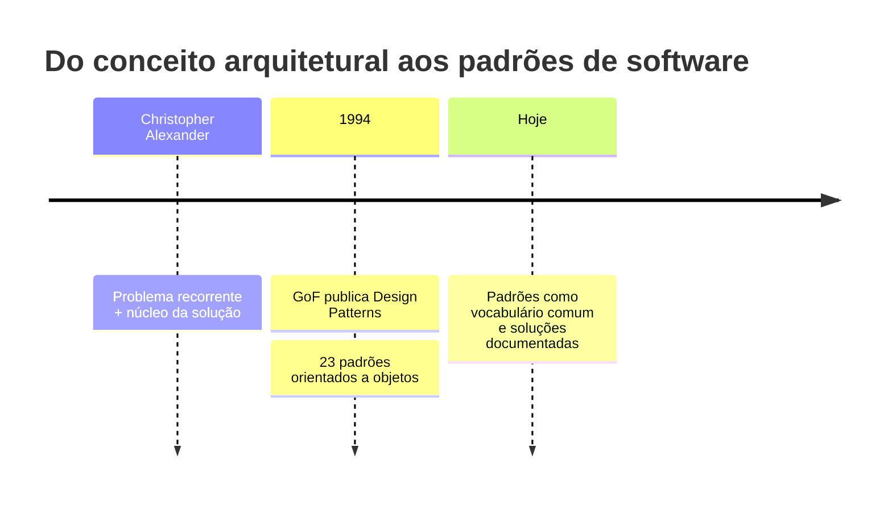

# Origem: de Alexander à Gang of Four

**Unidade 2 · Aula 2 — Prof. Nataniel Paiva**

O arquiteto Christopher Alexander descreveu um padrão como a relação entre um problema recorrente em determinado contexto e o núcleo de uma solução que pode ser reaproveitada sem ser aplicada sempre da mesma forma.

Em 1994, Erich Gamma, Richard Helm, Ralph Johnson e John Vlissides publicaram *Design Patterns: Elements of Reusable Object-Oriented Software*. O livro descreve 23 padrões orientados a objetos. Seus autores ficaram conhecidos como Gang of Four (GoF).

Um padrão é vocabulário de projeto e uma estrutura de colaboração, não um trecho de código para copiar. Reconhecemos um padrão por sua intenção e pelas relações entre participantes, mesmo que sua implementação varie.

