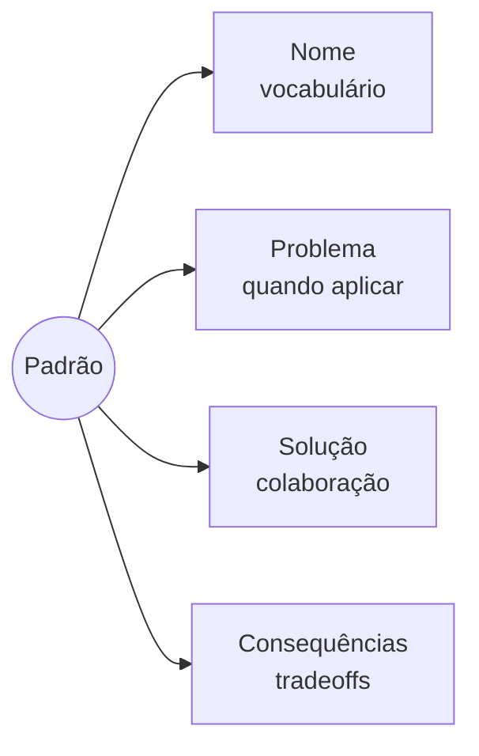

# Estrutura formal de um padrão

**Unidade 2 · Aula 2 — Prof. Nataniel Paiva**

Uma ficha útil deixa explícitos quatro elementos. O nome cria vocabulário comum; problema e aplicabilidade ajudam a reconhecer o contexto; solução descreve a colaboração; consequências tornam os tradeoffs visíveis.

| Elemento | Pergunta respondida |
|---|---|
| **Nome** | Como a equipe se refere à solução? |
| **Problema** | Em que situação e sob quais condições ela se aplica? |
| **Solução** | Que estrutura de classes e objetos colabora? |
| **Consequências** | O que se ganha e quais custos surgem? |

Diagramas de classe tornam papéis e dependências visíveis; não são contratos para reproduzir nomes ou código literalmente.
