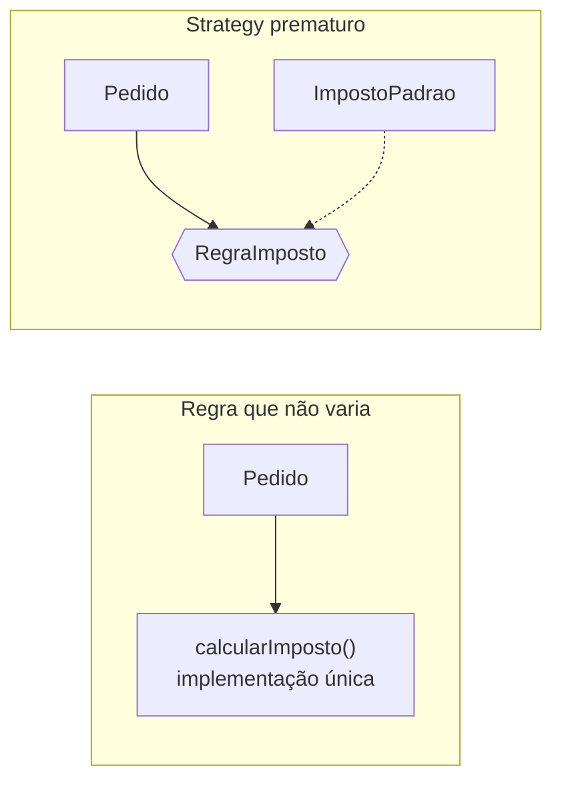

# Por que usar — e como evitar over-engineering

**Unidade 2 · Aula 2 — Prof. Nataniel Paiva**

Padrões ajudam a equipe a comunicar decisões com precisão, reutilizam soluções já discutidas e tornam conhecidos seus limites e armadilhas. Porém, adicionar abstrações também tem custo: mais classes, indireção, configuração, esforço de teste e, às vezes, desempenho.

## A regra prática

Use um padrão quando o problema já se manifestou ou está claramente previsto. Não crie flexibilidade apenas “por precaução”. Se uma regra é simples, única e não tem variação prevista, uma implementação direta é mais clara do que uma interface, uma estratégia concreta e uma seleção que não resolvem um problema atual.



**Exemplo adicional — Java:** o bloco simples abaixo é preferível se taxa e regra forem estáveis. Introduzir `RegraImposto` só passa a ajudar se a variação existir ou estiver claramente prevista.

```java
BigDecimal calcularImposto(Pedido pedido) {
    return pedido.total().multiply(TAXA_PADRAO);
}
```

O projeto também demonstra Strategy com comportamentos intercambiáveis em `GoFExamplesTest`; isso ilustra o padrão, não recomenda aplicar Strategy a toda regra.
