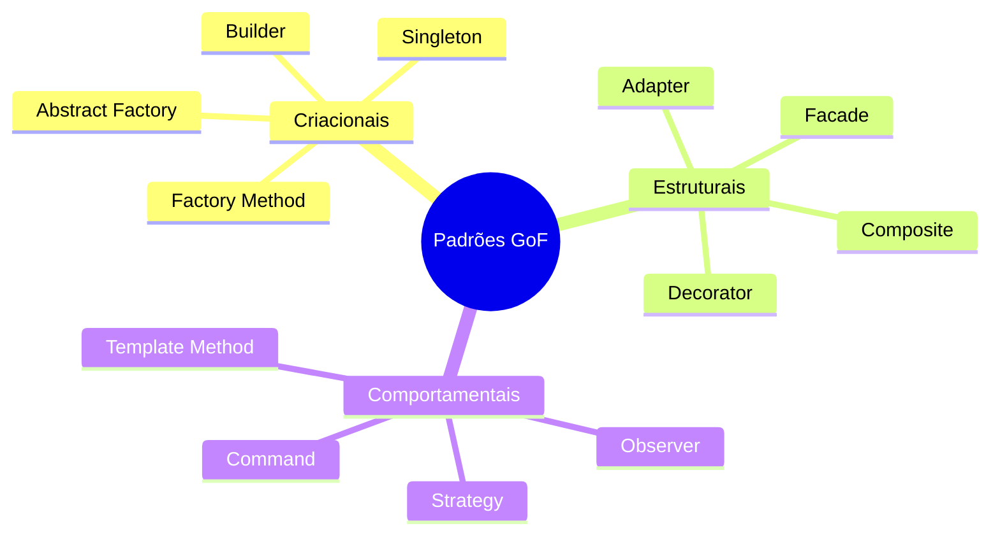

# Classificação GoF

**Unidade 2 · Aula 2 — Prof. Nataniel Paiva**

| Categoria | Propósito | Padrões deste guia |
|---|---|---|
| **Criacionais** | Controlar e flexibilizar a criação de objetos | Singleton, Factory Method, Abstract Factory, Builder |
| **Estruturais** | Compor classes e objetos em estruturas flexíveis | Adapter, Decorator, Facade, Composite |
| **Comportamentais** | Distribuir responsabilidades e algoritmos | Strategy, Observer, Template Method, Command |

> **Divergência registrada:** um slide diz “oito padrões representativos”, mas a tabela do material e a Aula 3 listam doze. Este catálogo segue a tabela e cobre os 12 acima.

Consulte [as fichas do catálogo](../catalogo/).
