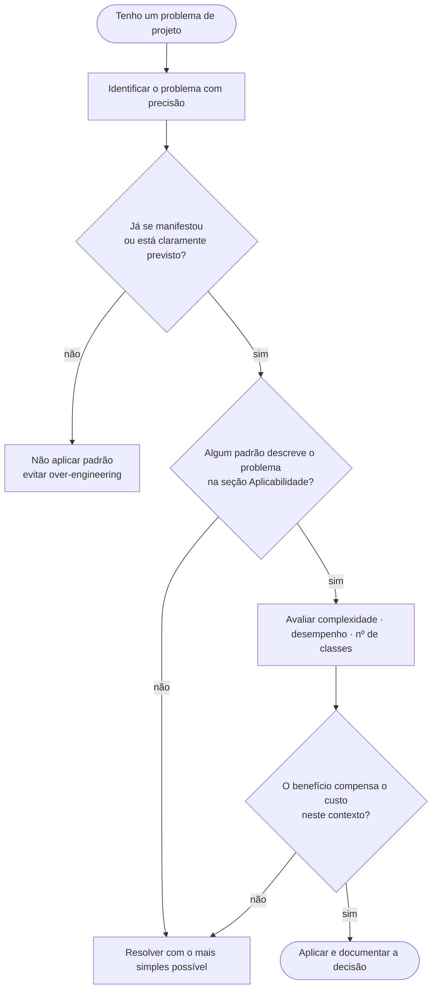

# Critérios de aplicabilidade

**Unidade 2 · Aula 2 — Prof. Nataniel Paiva**

Comece pela pergunta **“qual é exatamente o meu problema?”**, não pela busca de um padrão. Depois verifique a seção de aplicabilidade das alternativas e compare suas consequências com o contexto real.

Considere, no mínimo, complexidade, desempenho, quantidade de classes e custo de manutenção. Um padrão conhecido não é automaticamente a solução adequada; se o ganho não superar o custo, escolha a solução mais simples.

O [exercício de decisão](../exercicios/) propõe situações em que a resposta correta pode ser não usar padrão algum.
