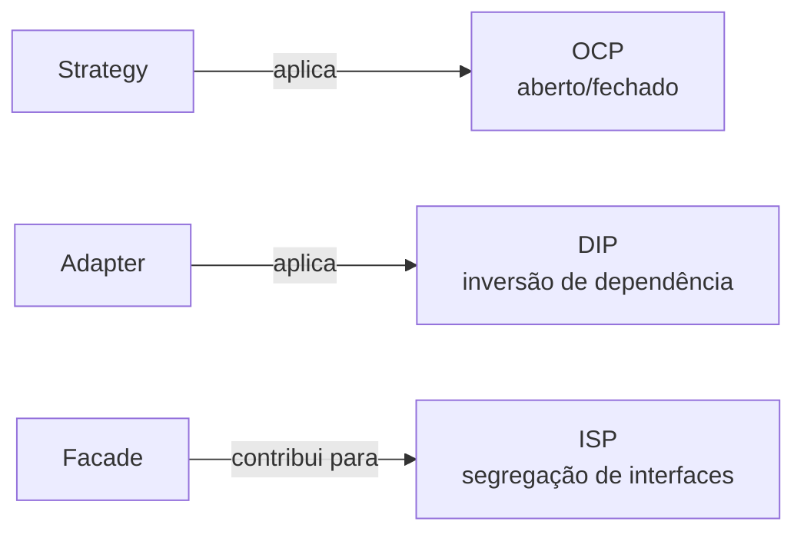

# Padrões e princípios SOLID

**Unidade 2 · Aula 2 — Prof. Nataniel Paiva**

Reconhecer o princípio por trás de uma colaboração evita memorizar padrões como receitas isoladas. As relações abaixo são contribuições comuns, não equivalências rígidas: o contexto e a implementação importam.

| Padrão | Relação | Princípio |
|---|---|---|
| **Strategy** | Novos algoritmos podem ser adicionados sem alterar o cliente. | **OCP** — Aberto/Fechado |
| **Adapter** | O cliente depende de uma interface da aplicação, não do detalhe externo. | **DIP** — Inversão de Dependência |
| **Facade** | O cliente recebe uma interface menor e focada para o subsistema. | **ISP** — Segregação de Interfaces |

**Exemplo adicional — Spring:** `FreightSelector` injeta uma `List<FreightStrategy>`, permitindo acrescentar beans de frete sem mudar o seletor. O exemplo de Adapter é um componente que implementa a interface da aplicação e encapsula a biblioteca externa; um serviço de fachada orquestra chamadas do subsistema. Strategy e Observer Spring têm exemplos executáveis neste projeto.
