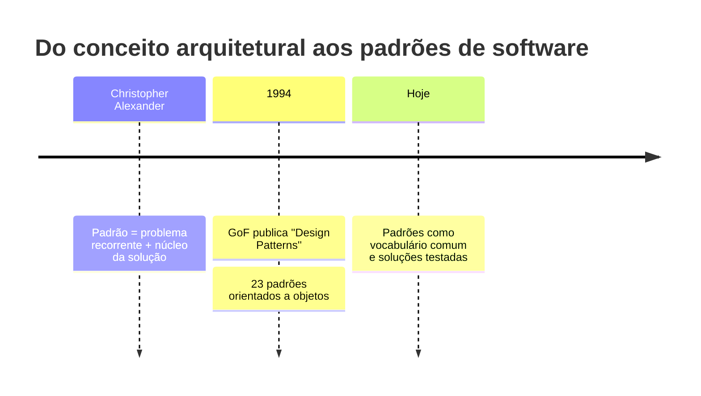
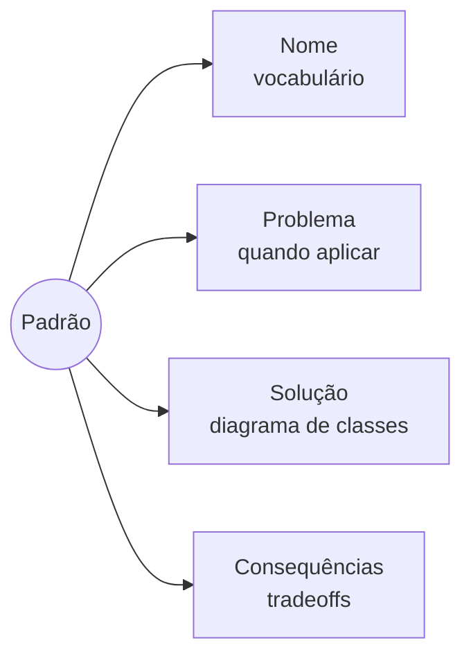
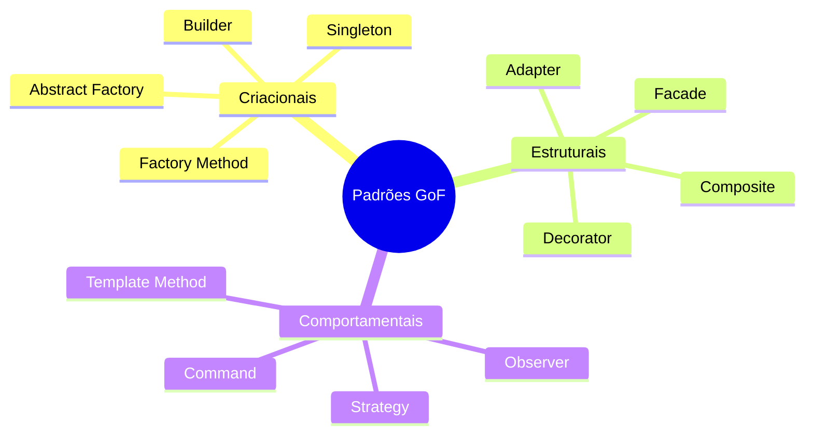
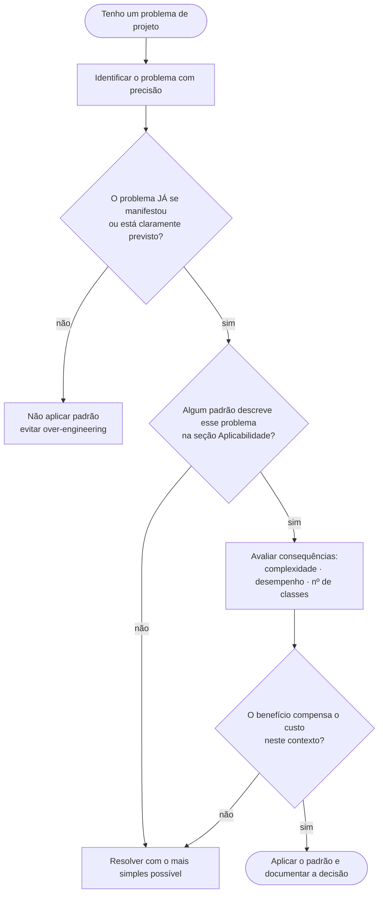
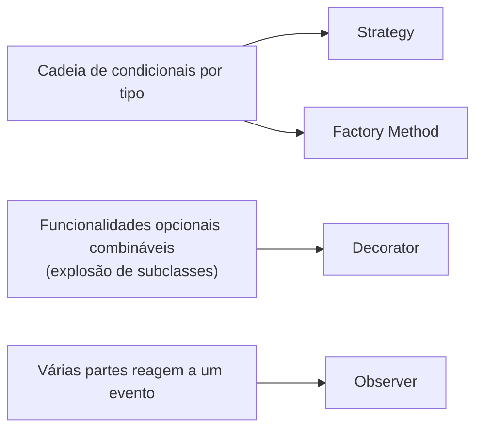
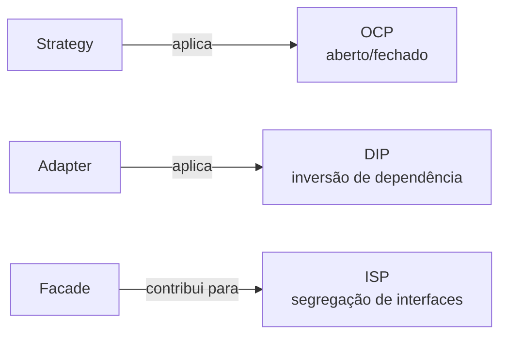
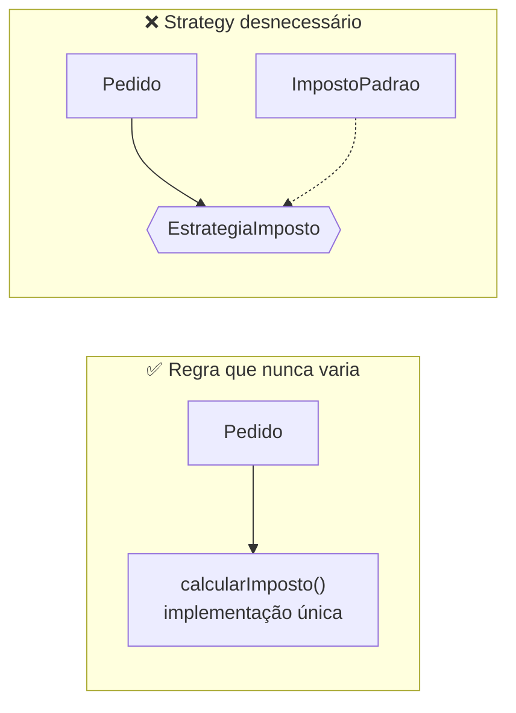

# Unidade 2 · Aula 2 — Padrões de Projeto: Conceitos, Motivação e Critérios de Aplicabilidade

> **Curso:** Arquitetura de Sistemas e Microsserviços · **Unidade 2 · Aula 2** · Prof. Nataniel Paiva
> **Fonte:** `Aula2_..._Padrões de Projeto Conceitos, Motivação e Critérios de Aplicabilidade_unidade02_aula02.pptx` (29 slides)

Este README é um **briefing para outra IA** criar um projeto visual sobre os fundamentos de padrões de projeto. Conteúdo extraído dos slides; diagramas Mermaid são **exemplos prontos** para o GitHub.

---

## 1. Objetivo do projeto a ser gerado

Um guia visual de **"o que são padrões, por que usar, como escolher e como evitar over-engineering"**, com catálogo navegável das três categorias GoF e a relação com SOLID.

**Idioma:** PT-BR. **Tom:** didático, com fluxos de decisão ilustrados.

### 1.1 Stack de código (obrigatória)

> **Todo código do projeto DEVE ser em Java com Spring.** Não gerar exemplos em outras linguagens.

- **Java 21 (LTS)** + **Spring Boot 3.x** · **Maven** · **JUnit 5**.
- Cada ficha do catálogo traz um exemplo curto em Java com **teste**; quando o Spring tiver um equivalente natural, mostrar a ligação (marcar como *exemplo adicional*):
  - **Strategy** → beans da mesma interface injetados por `List<>`/`Map<String, ...>` (aplica o **OCP**).
  - **Observer** → `ApplicationEventPublisher` + `@EventListener`.
  - **Adapter** → `@Component` que implementa a interface da aplicação e envolve a biblioteca externa (aplica o **DIP**).
  - **Facade** → um `@Service` que orquestra o subsistema (relaciona-se com o **ISP**).
- Exemplos de **over-engineering** também em Java (ex.: `Strategy` para uma regra que nunca varia), ao lado da versão simples.

## 2. Resumo do conteúdo (fonte de verdade)

### 2.1 Origem
- **Christopher Alexander** (arquiteto): padrão = descrição de um **problema recorrente em um contexto + o núcleo da solução**, reaproveitável sem nunca ser aplicado da mesma forma duas vezes.
- **1994:** Gamma, Helm, Johnson e Vlissides publicam *Design Patterns: Elements of Reusable Object-Oriented Software* — **23 padrões** OO; os autores são a **Gang of Four (GoF)**.

### 2.2 Estrutura formal de um padrão
| Elemento | Conteúdo |
|---|---|
| **Nome** | rótulo curto que vira vocabulário da equipe |
| **Problema** | situação e condições de aplicação |
| **Solução** | estrutura de classes e objetos (diagrama UML de classes) |
| **Consequências** | tradeoffs: flexibilidade, desempenho, complexidade |

> Um padrão descreve uma **estrutura de colaboração**, não código pronto. É reconhecido pela **intenção e estrutura**, não pelo código exato.

### 2.3 Por que usar
1. **Vocabulário comum** ("isso é um caso de Observer").
2. **Soluções testadas** para problemas recorrentes (vantagens, limites e armadilhas documentados).
3. **Risco:** **over-engineering** — ex.: Strategy para regra que comprovadamente nunca varia. Regra: aplicar quando o problema **já se manifestou ou está claramente previsto**, não "por precaução".

### 2.4 Classificação GoF (Tabela 1)
| Categoria | Propósito principal | Exemplos (Aula 3) |
|---|---|---|
| **Criacionais** | controlar e flexibilizar a criação de objetos | Singleton, Factory Method, Abstract Factory, Builder |
| **Estruturais** | compor classes e objetos em estruturas maiores e flexíveis | Adapter, Decorator, Facade, Composite |
| **Comportamentais** | distribuir responsabilidades/algoritmos entre objetos | Strategy, Observer, Template Method, Command |

> Nota: o slide diz que o curso cobre "oito padrões representativos", mas a Tabela 1 e a Aula 3 listam **doze**. A IA deve **seguir a tabela (12)** e registrar essa divergência em uma nota.

### 2.5 Critérios de aplicabilidade
1. Partir da pergunta **"qual é exatamente o meu problema?"** (e não "qual padrão posso usar?").
2. Verificar se algum padrão descreve esse problema na seção **aplicabilidade**.
3. Avaliar as **consequências** (complexidade, desempenho, nº de classes) e decidir se o ganho compensa o custo.

### 2.6 Sinais (code smell → padrão)
| Sintoma | Padrão provável |
|---|---|
| Cadeia longa de condicionais por tipo | **Strategy** ou **Factory Method** |
| Funcionalidades opcionais combináveis sem explosão de subclasses | **Decorator** |
| Várias partes reagem a um evento sem o gerador conhecê-las | **Observer** |

### 2.7 Padrões × SOLID
- **Strategy** → aplica **OCP** (novos algoritmos sem alterar o cliente).
- **Adapter** → aplica **DIP** (cliente depende de interface abstrata).
- **Facade** → contribui para **ISP** (interface simplificada e específica).
- Reconhecer o princípio por trás evita memorizar padrões como "receitas isoladas".

---

## 3. Exemplos Mermaid (renderizam no GitHub)

### 3.1 Linha do tempo



### 3.2 Anatomia de um padrão



### 3.3 Catálogo GoF por categoria



### 3.4 Fluxo de decisão: aplicar ou não um padrão (Figura do slide 23)



### 3.5 Code smell → padrão



### 3.6 Padrão ↔ princípio SOLID



### 3.7 Exemplo de over-engineering (contraponto visual, *exemplo adicional*)



---

## 4. Estrutura sugerida do projeto a gerar

```
unidade2-aula2-projeto/
├── README.md
├── docs/
│   ├── 01-origem-alexander-gof.md
│   ├── 02-estrutura-de-um-padrao.md
│   ├── 03-por-que-usar-e-over-engineering.md
│   ├── 04-classificacao-gof.md
│   ├── 05-criterios-de-aplicabilidade.md
│   └── 06-padroes-e-solid.md
├── diagramas/                 # .mmd fonte
├── catalogo/                  # ficha por padrão: nome · problema · solução · consequências
├── exercicios/                # "qual padrão (ou nenhum) resolve este problema?"
└── glossario.md
```

**Modelo de ficha do catálogo** (usar o mesmo para os 12 padrões): *Nome · Categoria · Problema · Solução (diagrama) · Consequências · Smell que sinaliza · Princípio SOLID relacionado*.

## 5. Regras para a IA que for gerar o projeto

1. Toda ficha de padrão segue os **4 elementos formais** (nome, problema, solução, consequências).
2. **Enfatize "quando NÃO usar"** — over-engineering deve ter exemplos próprios.
3. **Mermaid:** ```` ```mermaid ````; `flowchart` para decisão; `mindmap`/`timeline` para visão geral (suportados no GitHub); testar renderização.
4. Registrar a divergência "oito × doze padrões" em nota.
5. Marcar como *"exemplo adicional"* tudo que não está nos slides.
6. Citar: *Unidade 2 · Aula 2 — Prof. Nataniel Paiva*.

## 6. Checklist de aceitação

- [ ] Origem (Alexander → GoF 1994, 23 padrões)
- [ ] Estrutura formal de um padrão (4 elementos)
- [ ] Fluxo de decisão ilustrado
- [ ] Tabela das 3 categorias com os 12 exemplos
- [ ] Tabela smell → padrão e padrão ↔ SOLID
- [ ] Seção sobre over-engineering
